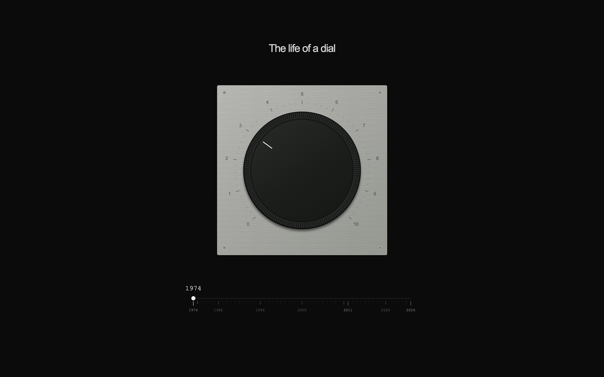
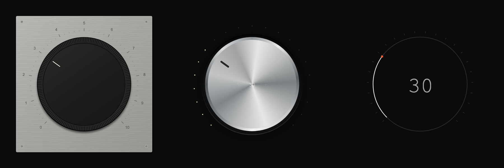

# The Life of a Dial

One rotary control, morphing continuously across 50 years of interface design. Scrub from a 1974 potentiometer, through 2011 brushed metal, to a 2026 haptic encoder. It's a single shared anatomy, with no separate dials swapped in per era.





## Features

- **Continuous morph.** Materials, geometry, and lighting interpolate year by year across all 53 years.
- **Tactile feedback.** Each era has its own synthesized WebAudio voice and vibration pattern.
- **Physical motion.** Critically damped settling with no bounce, plus detents and magnetic era anchors.
- **Accessible.** Full keyboard control, and reduced-motion support.
- **Fast.** Prerendered, one initial script, self-hosted fonts.

## Getting started

Requires Node 22+ and pnpm.

```sh
pnpm install
pnpm dev
```

Open [http://127.0.0.1:3048](http://127.0.0.1:3048).

## Episode 02: The Life of a Switch

Open [http://127.0.0.1:3048/switch](http://127.0.0.1:3048/switch).
The entire episode is in [`public/switch/index.html`](public/switch/index.html):
vanilla JavaScript, inline SVG/CSS, Google Fonts with optional display, and GSAP 3
from cdnjs. It can also be served independently without Nuxt.

One switch morphs from a 1965 steel toggle, through a 2007 glossy slide switch,
to a 2026 liquid switch. Drag past the over-center detent to commit, or tap.
The year slider supports arrows, Shift+arrows, Home, and End. Space/Enter flips
the focused switch. `1` / `2` / `3` select eras.

`R` plays the 15.6-second recording loop; `H` hides controls and the cursor;
`M` mutes sound; `Escape` stops playback and restores controls. Reduced motion
uses a 150 ms fade through a single object, with no geometric morph or stretch.
Sound requires a user gesture, and vibration depends on browser/device support.

## Controls

| Input | Action |
| --- | --- |
| Drag / scroll on dial | Change value |
| `←` `→` | Value ±1 (`Shift` ±10) |
| Drag timeline | Scrub years |
| `1` `2` `3` | Jump to 1974 / 2011 / 2026 |
| `R` | Play/stop the 17.6 s loop |
| `H` | Hide/show the timeline and cursor |
| `M` | Mute/unmute |
| `Esc` | Stop |

## Stack

[Nuxt 4](https://nuxt.com) · [Vue 3](https://vuejs.org) · [Tailwind CSS 4](https://tailwindcss.com) · [GSAP 3](https://gsap.com) · inline SVG · WebAudio

```
app/
├── components/DialTimeline.vue   # Shared dial anatomy + timeline
├── lib/morph.mjs                 # Pure material, geometry, and spring math
├── lib/controller.ts             # Input, GSAP ticker, recording
├── lib/renderer.ts               # Cached DOM writes
├── lib/tactile.ts                # Audio + haptics
├── lib/sound.mjs                 # Synthesized mechanical samples
└── lib/digits.ts                 # Digit transitions
```

## Scripts

| Command | Description |
| --- | --- |
| `pnpm dev` | Start the dev server |
| `pnpm build` | Build for Node deployment |
| `pnpm generate` | Generate a static site in `.output/public` |
| `pnpm verify` | Run unit tests, typecheck, build, and production checks |
| `pnpm test:browser` | Run Playwright tests against the production build |
